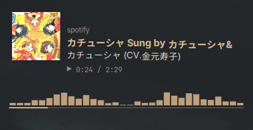
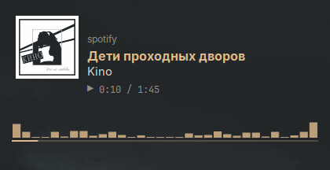
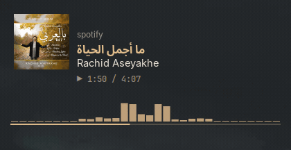
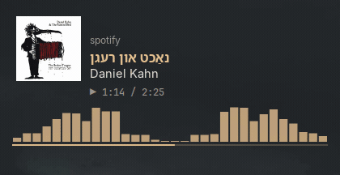
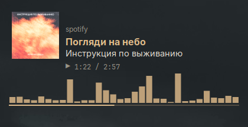
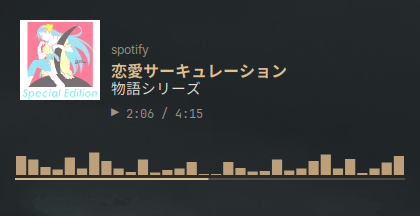

# conky-player

A media player widget for [Conky](https://github.com/brndnmtthws/conky) on Linux/X11.
It shows whatever is playing in any MPRIS-capable player (Spotify, browsers, mpv,
VLC, Rhythmbox, ...) with cover art, a scrolling title, an audio visualizer and a
progress line, and gets out of the way when nothing is playing.

<p align="center">
  
  
  
  
</p>

## Features

- **Any MPRIS player** via `playerctl`; picks the right one automatically when
  several are open (see [Player selection](#player-selection)).
- **Cover art** from `file://` and `http(s)://` art URLs.
- **Every script**: player name, title and artist are rendered with Pango, so
  Arabic and Hebrew run right to left with joined letters, Devanagari and other
  Indic scripts get their conjuncts, and Chinese, Japanese and Korean mix with
  Latin on one baseline. Characters the main font lacks fall back to other
  installed fonts.
- **Smooth marquee**: titles and artists that do not fit scroll back and forth
  pixel by pixel; right-to-left text starts at its right end. Short ones stay
  still.
- **cava visualizer** and a **progress line** drawn with cairo in a second window.
- **Auto-hide**: the panel disappears when no player is active, and the visualizer
  (and cava itself) stops while a window covers it, so it costs no CPU when you
  cannot see it.
- **One settings file** for position, width, colors, fonts and visualizer.

<p align="center">
  
  
</p>

## Requirements

- An **X11** session (not Wayland, see [Known limitations](#known-limitations))
- `conky` built with Lua, cairo and imlib2 bindings (`conky-all` on Debian/Ubuntu)
- `playerctl`, `cava`, `wmctrl`, `xprop` and `xwininfo` (`x11-utils`), `curl`, `python3`
- Python Pango bindings (`python3-gi`, `python3-gi-cairo`, `gir1.2-pango-1.0`;
  preinstalled on most GNOME, Cinnamon and MATE desktops). Without them titles
  fall back to plain text with no shaping or font fallback.
- Fonts: Inter, JetBrains Mono, DejaVu Sans, Noto Sans CJK (all replaceable in
  `settings.conf`)

On Debian, Ubuntu, Mint and derivatives:

```sh
sudo apt install conky-all playerctl cava wmctrl x11-utils curl python3 \
  python3-gi python3-gi-cairo gir1.2-pango-1.0 \
  fonts-inter fonts-jetbrains-mono fonts-dejavu-core fonts-noto-cjk
```

For titles in Arabic, Hebrew, Devanagari, Thai and other scripts you also need a
font that covers them; `fonts-noto-core` covers most:

```sh
sudo apt install fonts-noto-core
```

`install.sh` checks all of these and prints the exact command for whatever is
missing.

## Install

```sh
git clone https://github.com/lastlos/conky-player.git
cd conky-player
./install.sh
~/.config/conky-player/conky-player.sh start
```

`install.sh` copies the widget to `~/.config/conky-player` (or
`$XDG_CONFIG_HOME/conky-player`), never uses `sudo`, and keeps an existing
`settings.conf` when you run it again to update. Options:

| Option           | Effect                                             |
| ---------------- | -------------------------------------------------- |
| `--autostart`    | create the autostart entry without asking          |
| `--no-autostart` | do not create it and do not ask                    |

You can also run it straight from the cloned folder without installing:
`./conky-player.sh start`. All paths are resolved relative to the script.

### Usage

```sh
conky-player.sh start     # start (or restart) everything
conky-player.sh stop      # stop everything and remove runtime files
conky-player.sh restart   # same as start; use after editing settings.conf
conky-player.sh status    # show running processes
```

### Autostart

`./install.sh --autostart` writes `~/.config/autostart/conky-player.desktop`,
which runs `conky-player.sh start` five seconds after login (giving the
compositor time to start, so the transparent windows come up correctly). To
disable it, delete that file or turn it off in your desktop's "Startup
Applications".

## Uninstall

Stop the widget, then remove the installed files and the autostart entry:

```sh
~/.config/conky-player/conky-player.sh stop
rm -rf ~/.config/conky-player
rm -f ~/.config/autostart/conky-player.desktop
```

`stop` also removes the runtime files in `$XDG_RUNTIME_DIR/conky-player`.

Optionally remove the packages you installed only for this widget. Check first
that nothing else on your system uses them:

```sh
sudo apt remove conky-all playerctl cava wmctrl
sudo apt remove fonts-inter fonts-jetbrains-mono fonts-noto-cjk fonts-noto-core
```

Leave `curl`, `python3`, the Python Pango bindings, `x11-utils` and
`fonts-dejavu-core` installed; most desktops depend on them.

## Configuration

Edit `~/.config/conky-player/settings.conf` and run `conky-player.sh restart`.
One `key = value` per line; lines starting with `#` are comments.

| Key            | Default            | Meaning                                                  |
| -------------- | ------------------ | -------------------------------------------------------- |
| `alignment`    | `top_left`         | `top_left`, `top_middle`, `top_right`, `bottom_left`, `bottom_middle`, `bottom_right` |
| `gap_x`        | `40`               | distance from the left/right screen edge (px)            |
| `gap_y`        | `40`               | distance from the top/bottom screen edge (px)            |
| `width`        | `380`              | widget width (px); the cover takes 80 px of it           |
| `color_text`   | `#E6DFD3`          | artist text                                              |
| `color_accent` | `#E3BE8C`          | title, visualizer bars, progress line                    |
| `color_dim`    | `#9A9488`          | player name, play time                                   |
| `font`         | `Inter`            | main font                                                |
| `font_mono`    | `JetBrains Mono`   | play time                                                |
| `font_symbol`  | `DejaVu Sans`      | play/pause symbol                                        |
| `font_cjk`     | `Noto Sans CJK JP` | first fallback for characters `font` lacks (picks the CJK style) |
| `visualizer`   | `yes`              | `no` never starts cava; only the progress line is drawn  |
| `viz_height`   | `50`               | height of the visualizer bars (px)                       |
| `viz_bars`     | `32`               | number of bars                                           |
| `viz_fps`      | `60`               | visualizer frame rate (cava and Conky redraw)            |
| `cava_input`   | `pulse`            | cava input method (`pulse` also works on PipeWire)       |
| `cover_ignore` | `conky nemo-desktop hidamari` | window classes that never hide the visualizer |

Colors are `#RRGGBB`. Font names are fontconfig family names; list them with
`fc-list : family`. Missing keys fall back to the defaults above.

## How it works

```
playerctl ──> scripts/daemon.sh ──> $XDG_RUNTIME_DIR/conky-player/
                    │                   snapshot   one tab-separated line
                    │                   cover-<id> cover art, one file per art URL
                    │                   text-<id>  name, title, artist as PNGs
                    │                   viz-off    present while covered / idle
                    ├─> render-text.py  (Pango, once per track)
                    └─> cava-run.sh ──> cava       latest cava frame
                                            │
          conky/panel.conf + panel.lua <────┤  text panel (0.2 s refresh)
  conky/visualizer.conf + visualizer.lua <──┘  bars + progress (viz_fps)
```

`daemon.sh` polls once a second and is the only process that talks to
`playerctl`; the two Conky windows just read files from the runtime directory
(a tmpfs), so they stay cheap even at 60 fps.

Conky's own text cannot shape complex scripts or fall back to other fonts, so
when the player, title or artist changes the daemon has `render-text.py` draw
them once with Pango into transparent PNGs. The panel only scrolls and paints
those images.

### Player selection

Every second the daemon lists all MPRIS players (ignoring `playerctld`) and
picks the active one in this order:

1. A player that **just started playing** wins, even if another one is already
   playing. Starting a video in the browser switches the widget to it.
2. Otherwise the current player stays as long as it is **playing**.
3. If it stopped, the first other player that is **playing** takes over.
4. If nothing is playing, the current player stays if it is **paused**, else the
   first paused player is shown.
5. If no player is playing or paused, the widget hides.

The player name is shown without its instance suffix
(`chromium.instance1234` becomes `chromium`).

### Auto-hide

- **No player**: the daemon removes the snapshot and the panel renders nothing.
- **Paused**: the panel stays; cava is stopped and only the progress line is drawn.
- **Covered**: the daemon finds the visualizer window's position in the X window
  tree and checks whether a normal or dialog window on the current desktop (or a
  sticky one) covers its centre. Minimized windows, desktop windows and classes
  in `cover_ignore` do not count. While covered, cava is stopped and nothing is
  drawn. Conky windows sit below all other windows, so this only saves work; it
  does not change what you see.

## Tested on

- Linux Mint 22.3 Cinnamon (X11)
- Conky 1.19.6 (`conky --version`: `conky 1.19.6 compiled 2024-04-01 for Linux x86_64`)
- cava 0.7.4 (Ubuntu package `0.7.4-1build2`; this version's `cava -v` prints no
  version number)

## Known limitations

- **X11 only.** Window detection uses `wmctrl`, `xprop` and `xwininfo`, and Conky's
  transparent desktop windows rely on X11. It does not work on Wayland
  (XWayland is not enough to see other windows).
- **cava shows system-wide audio**, not the selected player. Notification sounds
  or a second player will show up in the bars.
- **Right-to-left titles are left-aligned** like the rest of the panel; only
  their scrolling starts from the right.
- **Color emoji** depend on the installed emoji font and may render in
  monochrome or not at all.
- **Coverage is checked at a single point** (the visualizer's centre), so a
  window covering only part of it is ignored.
- **Fixed panel height.** The visualizer is placed 110 px from the panel; much
  larger fonts will overlap it. `middle_*` alignments are not supported because
  the two windows would overlap.
- Some players do not report art URLs, length or position; the widget then shows
  no cover or an empty progress line.

## Troubleshooting

**Nothing appears.** Check `conky-player.sh status` and `playerctl -l`. If a player
is listed but nothing shows, run the panel in the foreground to see Conky's errors:

```sh
export CONKY_PLAYER_DIR=~/.config/conky-player
conky -c ~/.config/conky-player/conky/panel.conf
```

Errors about `cairo_*` functions or `lua_load` mean Conky was built without
Lua cairo/imlib2 bindings; install `conky-all`.

**Black or opaque background.** Conky needs a compositor for ARGB transparency.
Most desktops run one; on plain window managers start `picom` first.

**Visualizer stays empty.** Check that cava works on its own (`cava`). On
PipeWire make sure `pipewire-pulse` is running, or (with cava 0.8 or newer) set
`cava_input = pipewire`.

**Visualizer never shows / is always hidden.** Some window is probably counted as
covering it, such as a desktop or wallpaper app. Find its class with
`wmctrl -lx` and add it to `cover_ignore`.

**Boxes instead of letters.** No installed font has those characters. Install
`fonts-noto-cjk` for Chinese, Japanese and Korean and `fonts-noto-core` for most
other scripts; `fc-list :lang=ar family` lists fonts for a language (here Arabic).

**Arabic letters not joined, or Hindi letters broken apart.** The Python Pango
bindings are missing and the panel fell back to plain text. Install
`python3-gi python3-gi-cairo gir1.2-pango-1.0` and restart.

**Wrong player is shown.** The newest player to start playing wins; pause it, or
see `playerctl -l` for what the daemon sees.

## License

[GPL-3.0](LICENSE)
